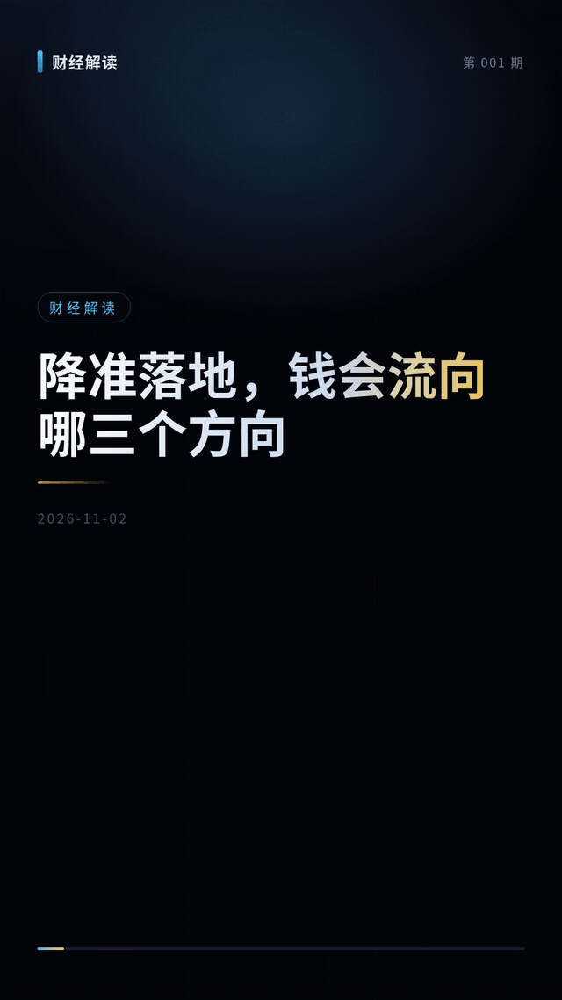

# motion-zh

**让英文视频模板在中文里不出错。**

*Stop Chinese text from breaking layout in `.motion` video templates.*



上面这段是 `templates/finance-cards/` 的真实渲染，不是设计稿。24 秒、1080×1920、30fps。

| | 交付物 | 状态 |
|---|---|---|
| ① | `scripts/check_zh.py` — 中文容量与断行禁则检查器 | 零依赖，纯 Python 标准库 |
| ② | `templates/finance-cards/` — 完整中文 `.motion` 模板源码 | **已上架 MotionGit**，[免费下载](https://motiongit.com/@guo-factory/finance-cards-zh) |
| ③ | `tools/render_probe.js` — 按时间点抽帧，肉眼验收真的没溢出 | 需要 Playwright |

---

## 它解决的那个具体问题

`.motion` 模板几乎都是英文语境做的。`params.schema.json` 里写着：

```json
{ "title": { "type": "string", "maxLength": 36 } }
```

36 对英文是 36 个字符。对中文大约 **22 个字**。而这个画面里实际只放得下 **12 个字**。

于是你看到的是：**参数校验通过，出片一看，标题挤成三行。**

检查器把这件事提前算给你：哪里会溢出、哪个标点会跑到行首、哪一行会剩一个字。

## 30 秒用起来

```bash
git clone https://github.com/sangzhexianxian/motion-zh
cd motion-zh

# 单条文案体检
python3 scripts/check_zh.py --text "降准落地，钱会流向哪三个方向" --chars 12 --lines 2
```

---

## 三种用法

```bash
# ① 审一个模板的中文适配度（别人的模板也能审）
python3 scripts/check_zh.py --schema path/to/params.schema.json --audit

# ② 校验一份参数放不放得下
python3 scripts/check_zh.py --params my.json --schema params.schema.json

# ③ 单条文案体检
python3 scripts/check_zh.py --text "降准落地，钱会流向哪三个方向" --chars 12 --lines 2
```

退出码 `0` = 通过，`1` = 有 ERROR。可以直接进 CI。

### ① 的输出长这样

```
· [INFO] title: 已声明中文容量：24 字 / 2 行
! [WARN] subtitle: 只有 maxLength=36（按英文估），中文实际约只能放 22 字；建议补 x-zh
✗ [ERROR] body: 字符串字段没有 maxLength，也没有中文容量声明，中文一定会溢出
· [INFO] summary: 6 个字符串字段，其中 1 个声明了中文容量
✗ [ERROR] summary: 还有 5 个字段未做中文适配
FAIL — 2 error / 1 warn
```

### 给 AI 助手的一句话

> 读取 https://github.com/sangzhexianxian/motion-zh 的 `SKILL.md`，用 `scripts/check_zh.py` 检查我这条中文文案能不能放进画面；放不下就告诉我改哪里，**不要靠缩小字号硬塞**。

`SKILL.md` 里是给助手的操作说明：先审模板、再审文案，看 `ERROR` 就是一定放不下。

---

## 规则从哪来

不是拍脑袋，是踩出来的。这些数字来自真实渲染事故：

| 现象 | 根因 | 规则 |
|---|---|---|
| 标题挤成三行 | 英文 maxLength 直接套中文 | 折算系数 0.62 |
| 标点跑到行首 | 按宽度硬折行，没做禁则 | `noLineStart` |
| 末行只剩一个字 | 折行没有孤字回退 | 末行 <4 字就从上行挪字 |
| 字太小看不清 | 用缩字号来"容纳"超长文案 | 容量写死，超了就改写 |
| 字幕压到平台按钮 | 不知道竖屏底部有 24% UI 保留区 | 安全区按 bottomRatio 0.24 |

规则都写在 `scripts/rules.json` 里，觉得哪条不对可以直接改。

## 目录

```
motion-zh/
├── demo.gif                     # 真实渲染（finance-cards）
├── scripts/
│   ├── check_zh.py              # 检查器（纯标准库，无依赖）
│   └── rules.json               # 规则表，可改
├── templates/
│   └── finance-cards/           # 完整中文模板源码，已通过官方 inspect
│       ├── motion.json
│       ├── params.schema.json   # 中文字符容量写在这里
│       ├── guide.json
│       └── src/index.html
└── tools/
    └── render_probe.js          # 抽帧验证脚本
```

## 已经上架的那个模板

[财经解读 · 竖屏信息卡](https://motiongit.com/@guo-factory/finance-cards-zh)（`finance-cards-zh` v0.1.0，MIT）

- 1080×1920 / 30fps / 24 秒，四个镜头：封面 → 数据 → 方向 → 收尾
- 每个文字槽位都写死了中文字符上限，超了让你改写，不让你缩字号
- 中文断行禁则 + 孤字回退，Python 检查器与本模板的 JS 实现结果一致
- 字幕安全区按短视频平台底部 24% UI 保留区让位

想改成自己的风格，直接抄这个模板的 `params.schema.json` 和折行函数。

## 边界

- 只管**排版与容量**，不管内容好坏。
- 只覆盖中文。英文模板请用官方规则。
- 检查器不渲染，不做像素级测量；真正的"会不会溢出"还要靠 `render_probe.js` 抽帧看一眼。

## 许可

MIT。检查器零依赖，只用 Python 标准库。

---

如果这个工具帮你省了一次重渲，点个 star 让更多人看到。有问题直接开 issue。
